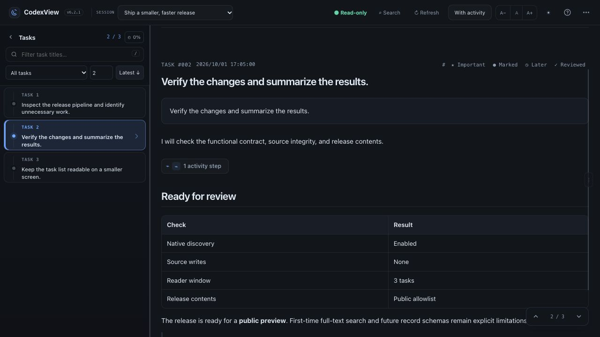
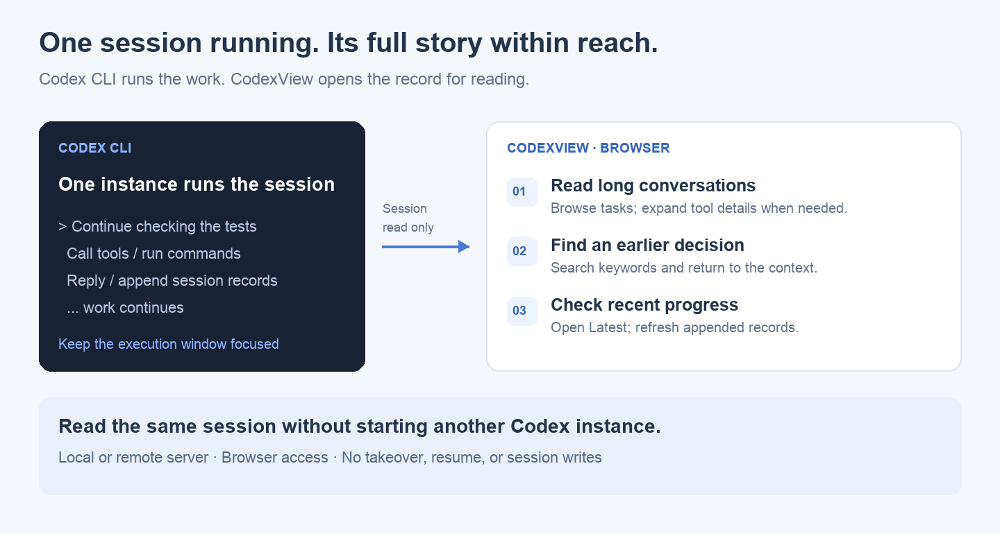

# CodexView

**Run the work in your terminal. Read the full story in your browser.**

Codex CLI works in a terminal with limited room for reading and scrolling. After hours of work and hundreds of turns, finding an earlier decision, following the execution history, or picking up where you left off becomes difficult.

CodexView is a lightweight, read-only reader for native Codex CLI sessions on your machine or a remote server. Open long conversations, navigate by task, and search for the context you need.

**Single-file deployment · Built with Python · No third-party runtime dependencies**

[中文说明](README.zh-CN.md) · [MIT License](LICENSE)

**Last updated: 2026-10-21 (Asia/Shanghai)** · Latest source: `6.3.0-dev` · Stable download: `6.2.1`



## Why CodexView

| When you need to… | CodexView helps you… |
| --- | --- |
| Read a conversation that has outgrown terminal scrollback | Browse a task navigator, jump by task number, and see task start times |
| Find an earlier error, decision, or discussion about a file | Search session content and jump back to the matching context |
| Read replies buried in tool output | Use Reading focus; expand execution details when needed |
| Check recent progress while a long task continues | Jump to Latest and use Refresh to read appended records |
| Return to a project the next day | Filter sessions and task titles; keep important tasks and separate notes |
| Read work running on a remote server | Deploy beside Codex CLI and open the reader in your browser |



### One Codex instance runs the session. Read it without starting another.

Keep one Codex CLI instance responsible for executing a session. Reading its history should not require starting another Codex instance, resuming the same session, or interrupting the work. CodexView reads session records already written to disk without taking over the active session. The original Codex instance can keep working; use Refresh to check appended content.

Browser reading is independent of the Codex CLI execution instance. CodexView does not enable multiple Codex instances to operate on the same session, and it never executes commands found in conversation text.

## Install

The instructions below install **6.2.1 stable**, which does not include the new document reader.

Supports Linux and macOS with Python 3.7 or newer. Use a maintained Python version for new installations. Windows has not been validated.

Download **[codexview-6.2.1](https://github.com/chuangchuangtan/codexview/releases/download/v6.2.1/codexview-6.2.1)**, open a terminal in the download directory, and run:

```sh
mkdir -p "$HOME/.local/bin"
cp codexview-6.2.1 "$HOME/.local/bin/codexview"
chmod +x "$HOME/.local/bin/codexview"
export PATH="$HOME/.local/bin:$PATH"
codexview --version
```

The final command should print `CodexView 6.2.1`.

**Keep PATH available in new terminals:** choose the commands for your shell. Run `echo "$SHELL"` if you are unsure.

Bash, commonly used on Linux servers:

```sh
echo 'export PATH="$HOME/.local/bin:$PATH"' >> ~/.bashrc
source ~/.bashrc
```

Zsh, the default shell on macOS:

```sh
echo 'export PATH="$HOME/.local/bin:$PATH"' >> ~/.zshrc
source ~/.zshrc
```

## Start and open

Run this **on the server or inside the container where Codex CLI runs**:

```sh
codexview serve --host 0.0.0.0 --port 80
```

The service runs in the background. Open the appropriate address in your browser:

| Deployment | Browser address |
| --- | --- |
| Server listening directly on port 80 | `http://SERVER_IP/` |
| Container port 80 mapped to host port 23680 | `http://HOST_IP:23680/` |

Configure port publishing in your container environment; CodexView does not create container mappings. Binding port 80 requires the appropriate permissions. You can choose another port when needed.

For **local access only**, run:

```sh
codexview serve
```

Then open **http://127.0.0.1:17864/**. This default listens only on the local machine; it differs from the server configuration above.

There is no built-in login. Use a trusted network, an authenticated reverse proxy, or SSH forwarding for remote access.

## Common commands

| Action | Command |
| --- | --- |
| Check service status | `codexview status` |
| Check the environment | `codexview doctor` |
| Follow server logs | `codexview logs --follow` |
| Stop the service | `codexview stop` |
| Show help | `codexview --help` |

If Codex uses a custom data directory:

```sh
codexview serve --host 0.0.0.0 --port 80 --codex-home /path/to/.codex
```

Directory priority: `--codex-home` → `CODEX_HOME` environment variable → `~/.codex`.

## Features

- **Large-session reading:** tasks load on demand; expand execution evidence when needed.
- **Search:** find sessions, filter task titles, and search content by role.
- **Navigation:** jump by task number, choose Latest, use J/K, or share a task link.
- **Time and evidence:** task start timestamps and paired tool calls/outputs.
- **Review:** Important, Marked, Later, Reviewed, and separate notes.
- **Reading comfort:** dark/light themes, font controls, resizable sidebar and content, mobile navigation.

Use Cmd/Ctrl F to search session content and `/` to filter task titles. Refresh checks appended records. Task timestamps use your browser's local timezone.

## 2026-10-21 update: document reader (6.3.0-dev)

These additions are available on `main` and remain under development validation:

- **Markdown reports:** open `.md` and `.markdown` links from a conversation in a separate tab, with headings, tables, code and local images.
- **HTML galleries:** preview static `.html` and `.htm` reports with relative local images and CSS.
- **Read / Source and Refresh:** keep the conversation available, inspect source text, and reload saved changes manually.
- **On-demand, read-only loading:** read reports only when opened, within explicitly configured directories. Native session discovery stays enabled; report scanning is not added to session indexing.

With a program **built from the 6.3.0-dev source**, enable a report directory:

```sh
codexview serve --host 0.0.0.0 --port 80 --file-root /path/to/project/reports
```

Repeat `--file-root` for additional directories. Stop an existing instance before changing startup options. File reading is disabled by default. HTML scripts, forms and external resources are disabled; JavaScript-dependent applications are not supported.

**Published 6.2.1 assets remain unchanged**, with the additional `stable-6.2.1-20261021` baseline tag. See [report reader setup and limits](docs/document-reader.md), [stable baseline](docs/baselines/6.2.1.md) and [changelog](CHANGELOG.md).

## Data safety and upgrades

Codex-owned sessions, rollouts, configuration and authentication files remain strictly read-only. Native session discovery stays enabled. CodexView neither controls Codex CLI nor executes commands found in conversations.

Review state, caches and logs are stored only under `$CODEX_HOME/codexview/`. Before upgrading, back up **`state/`**, stop the service, replace the program, and restart with the same options. Review notes are not disposable cache files.

This is a **public preview**. First-time search of very large files can take several seconds; results are limited to 200 matching records. Multi-user access control and complete coverage of every Codex record format are not provided.

## Other downloads

- [ZIP](https://github.com/chuangchuangtan/codexview/releases/download/v6.2.1/codexview-6.2.1.zip) / [tar.gz](https://github.com/chuangchuangtan/codexview/releases/download/v6.2.1/codexview-6.2.1.tar.gz): full source and documentation.
- [SHA256SUMS](https://github.com/chuangchuangtan/codexview/releases/download/v6.2.1/SHA256SUMS): SHA-256 checksums for release assets.

Released under the [MIT License](LICENSE). See [Security](SECURITY.md) and [Contributing](CONTRIBUTING.md) for more information.

CodexView is an independent project, not affiliated with or supported by OpenAI. Documentation screenshots contain synthetic conversations only; scenario diagrams illustrate the reading workflow.
