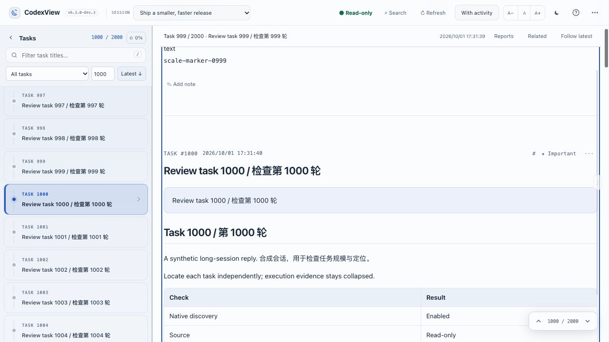
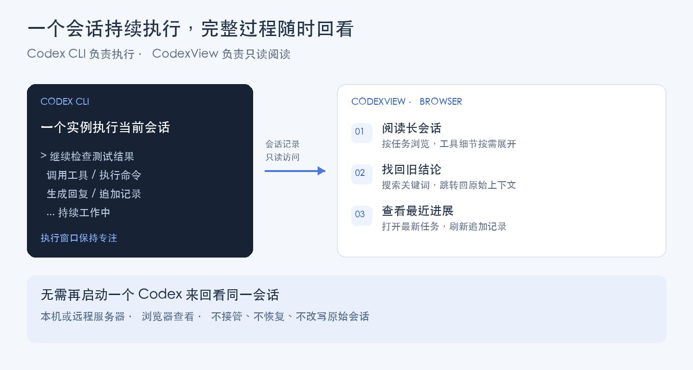

<div align="center">
  <h1>CodexView</h1>
  <p><strong>上千轮长会话，也能清晰回看。</strong></p>
  <p>终端继续执行，浏览器按任务阅读、搜索、定位。</p>
  <p><code>1,000+ 轮对话</code> · <code>按需加载</code> · <code>单文件部署</code> · <code>严格只读</code></p>
  <p><a href="https://github.com/chuangchuangtan/codexview/releases/tag/v6.3.0-dev.4">下载当前版本</a> · <a href="README.md">English</a> · <a href="LICENSE">MIT 许可证</a></p>
</div>

CodexView 是为**数百至上千轮长会话**设计的轻量 Codex CLI 阅读器。将本机或远程服务器上的对话、工具执行与 Markdown / HTML 报告整理为清晰的网页，方便回看完整过程、查找关键结论、接着上次的位置阅读。

| **长会话，按任务读** | **找记录，带着上下文** | **部署轻，原始数据只读** |
| --- | --- | --- |
| 上千轮任务目录，内容按需加载，按任务号直达 | 正文搜索、任务时间、阅读位置恢复与报告阅读 | 单文件部署，Python 标准库运行，无第三方运行依赖 |

**规模验证**：已验证 2,000 轮合成会话，以及 755 个任务、约 616 MB 的真实会话；两组验证分别覆盖任务规模与大文件场景。[查看验证范围与性能记录](docs/performance.md#task-count-validation-2026-10-21)。

**最近更新：2026-10-22（北京时间）** · 当前版本：`6.3.0-dev.4` · 开发预览版



## 为什么需要 CodexView

| 你遇到的情况 | 用 CodexView 做什么 |
| --- | --- |
| 会话太长，终端里来回滚动仍找不到位置 | 按任务目录阅读，按任务号跳转，查看每个任务的开始时间 |
| 想找之前的报错、方案或某个文件的讨论 | 搜索正文并跳回匹配位置，连同上下文一起阅读 |
| 工具输出很多，关键回复被淹没 | 使用 Reading focus 阅读请求与回复，需要时再展开执行细节 |
| 长任务仍在运行，只想查看最近做了什么 | 收到新增内容提示后再刷新，或主动开启 Follow latest 跟随 |
| 隔天接着工作，需要找回关键结论 | 筛选会话和任务标题，用收藏标记与独立笔记留下线索 |
| Codex 跑在远程服务器，想在本机舒服地阅读 | 在服务器部署一次，从浏览器访问会话 |



### 一个 Codex 执行，同一会话随时回看

一个 session 交给一个 Codex CLI 实例执行。为了回看记录，无需再启动另一个 Codex、恢复同一个 session，或打断当前工作：CodexView 只读访问已落盘的会话记录，不接管正在执行的会话。查看期间，原来的 Codex 可以继续工作；收到新增内容提示后刷新，或主动开启 Follow latest。

浏览器查看与 Codex CLI 的执行实例相互独立。CodexView 不提供多个 Codex 实例同时操作同一会话的能力，也不将会话中的文本当作命令执行。

## 安装

以下安装的是 **6.3.0-dev.4 开发预览版**，包含连续阅读、Markdown 和静态 HTML 报告阅读。

升级前先运行 `codexview stop`，备份审阅记录，再替换程序。

支持 Linux 和 macOS，需要 Python 3.7 或更新版本。推荐使用仍受维护的 Python。Windows 暂未验证。

下载发布文件 **[codexview-6.3.0-dev.4](https://github.com/chuangchuangtan/codexview/releases/download/v6.3.0-dev.4/codexview-6.3.0-dev.4)**，在下载目录打开终端，依次执行：

```sh
mkdir -p "$HOME/.local/bin"
cp codexview-6.3.0-dev.4 "$HOME/.local/bin/codexview"
chmod +x "$HOME/.local/bin/codexview"
export PATH="$HOME/.local/bin:$PATH"
codexview --version
```

最后显示 `CodexView 6.3.0-dev.4` 即表示安装成功。

历史基线：[6.2.1](https://github.com/chuangchuangtan/codexview/releases/tag/v6.2.1)。不同版本的功能与文件请以对应 Release 为准。

**将 PATH 永久保存**：根据使用的终端选择一组命令。可运行 `echo "$SHELL"` 查看当前终端类型。

Bash（常见 Linux 服务器）：

```sh
echo 'export PATH="$HOME/.local/bin:$PATH"' >> ~/.bashrc
source ~/.bashrc
```

Zsh（macOS 默认终端）：

```sh
echo 'export PATH="$HOME/.local/bin:$PATH"' >> ~/.zshrc
source ~/.zshrc
```

## 启动与访问

在**运行 Codex CLI 的服务器或容器内**执行：

```sh
codexview serve --host 0.0.0.0 --port 80
```

服务默认在后台运行，随后在浏览器访问服务器地址。

| 部署方式 | 浏览器访问地址 |
| --- | --- |
| 服务器直接监听 80 | `http://服务器IP/` |
| 容器内 80 映射到宿主机 23680 | `http://宿主机IP:23680/` |

容器端口映射需在容器环境中配置，CodexView 不会自动创建映射。80 端口需要相应绑定权限，普通用户也可选用其他端口。

**仅在本机查看**时，可以直接运行：

```sh
codexview serve
```

然后打开 **[http://127.0.0.1:17864/](http://127.0.0.1:17864/)**。这是默认配置，只允许本机访问，与上面的服务器部署方式不同。

工具不内置登录认证。请在可信网络内使用；需要公网访问时，请配置认证反向代理，或使用 SSH 转发。

## 常用操作

| 操作 | 命令 |
| --- | --- |
| 查看运行状态 | `codexview status` |
| 检查运行环境 | `codexview doctor` |
| 实时查看日志 | `codexview logs --follow` |
| 停止服务 | `codexview stop` |
| 查看帮助 | `codexview --help` |

Codex 数据不在默认目录时，指定实际位置：

```sh
codexview serve --host 0.0.0.0 --port 80 --codex-home /path/to/.codex
```

目录优先级：`--codex-home` → `CODEX_HOME` 环境变量 → `~/.codex`。

## 功能

- **快速阅读大会话**：任务按需加载，执行活动展开后读取。
- **查找内容**：检索会话、筛选任务标题，按角色搜索正文。
- **快速定位**：任务号直达、Latest、J/K 前后切换、任务链接。
- **时间与证据**：显示任务开始时间，合并展示工具调用和输出。
- **审阅记录**：Important、Marked、Later、Reviewed 与独立笔记。
- **舒适阅读**：明暗主题、字体调整、可拉伸侧栏与正文宽度、手机导航。

Cmd/Ctrl F 搜索会话内容，`/` 筛选任务标题。点击 Refresh 检查新追加的记录。任务时间按浏览器本地时区显示。

## 2026-10-21 更新：连续阅读（6.3.0-dev.4）

**2026-10-22 · 6.3.0-dev.4 修复：**恢复 Important / Marked / Later / Reviewed、笔记保存及上下任务切换。保存后原位更新，失败时明确提示重试。

同时保留以下功能：

- **连续翻阅：**保留移出任务的高度，提前加载相邻正文，避免异步加载完成后拉回页面；超长单任务分块展示，保留搜索定位和阅读恢复。
- **查看运行进展：**页面可见时检查文件元数据并提示新增内容。Follow latest 需主动开启，手动翻阅会暂停跟随。
- **任务上下文：**顶部显示当前阅读任务的标题与时间，长回复中也能知道所在位置。
- **可选搜索加速：**在 **Search → Build search cache** 主动准备压缩缓存，支持中文子串、追加更新、取消与流式回退；进入会话时不会自动构建。
- **报告与图片：**汇集已阅读任务中的报告链接，支持本地图片放大及返回原报告；Related 仅展示原始元数据明确声明的父子或分叉关系。

保留 Markdown / 静态 HTML 阅读、源码切换、标题目录、段落恢复和可调整布局。报告仅在打开时读取，并受配置的项目目录限制。

安装 **6.3.0-dev.4** 后，指定可读项目目录即可打开报告：

```sh
codexview serve --host 0.0.0.0 --port 80 --file-root /path/to/project/reports
```

`--file-root` 是服务器上的项目工作目录，可与 Session 的 `cwd` 一致，例如 `/path/to/project`，无需指向 `.codex/sessions`。可重复添加 `--file-root`；更改启动参数前先停止现有服务。未指定目录时，文件阅读默认关闭。HTML 禁用脚本、表单和外部资源，暂不支持依赖 JavaScript 的交互页面。

**6.2.1 稳定发布包保持不变**，并保留 `stable-6.2.1-20261021` 基线标签。更多信息：[文档阅读配置与边界](docs/document-reader.md) · [稳定基线记录](docs/baselines/6.2.1.md) · [更新日志](CHANGELOG.md)。

## 数据安全与升级

Codex 原始 session、rollout、config、auth 数据严格只读，Native 会话发现始终开启。工具不操控 Codex CLI，也不运行会话中出现的命令。

审阅状态、缓存和日志仅保存在 `$CODEX_HOME/codexview/`。升级前请备份其中的 **`state/`** 目录，停止服务、替换程序，再使用原参数启动。不要删除审阅笔记来清理缓存。

搜索缓存包含可读的会话文本，存放在同一受保护运行目录中。每份上限 128 MiB，保留两份就绪缓存，构建时最多额外占用一份临时空间。[阅读操作与边界](docs/continuous-reading.md)。

当前为**公开预览版**。首次搜索超大文件可能需要数秒；搜索最多返回 200 条匹配记录。暂不提供多用户权限管理，尚未覆盖所有 Codex 记录格式。

## 其他下载

历史版本：[6.3.0-dev.3](https://github.com/chuangchuangtan/codexview/releases/tag/v6.3.0-dev.3)（连续阅读） · [6.3.0-dev.2](https://github.com/chuangchuangtan/codexview/releases/tag/v6.3.0-dev.2)（阅读精修） · [6.3.0-dev](https://github.com/chuangchuangtan/codexview/releases/tag/v6.3.0-dev)（最初的报告阅读预览） · [6.2.1](https://github.com/chuangchuangtan/codexview/releases/tag/v6.2.1)（旧版基线）。

- [ZIP](https://github.com/chuangchuangtan/codexview/releases/download/v6.3.0-dev.4/codexview-6.3.0-dev.4.zip) / [tar.gz](https://github.com/chuangchuangtan/codexview/releases/download/v6.3.0-dev.4/codexview-6.3.0-dev.4.tar.gz)：完整源码和文档。
- [SHA256SUMS](https://github.com/chuangchuangtan/codexview/releases/download/v6.3.0-dev.4/SHA256SUMS)：发布文件的 SHA-256 校验值。

采用 [MIT License](LICENSE)。更多信息：[安全说明](SECURITY.md) · [参与贡献](CONTRIBUTING.md)。

CodexView 是独立项目，与 OpenAI 无隶属或官方支持关系。文档截图仅使用虚构会话，场景图为使用方式示意。
