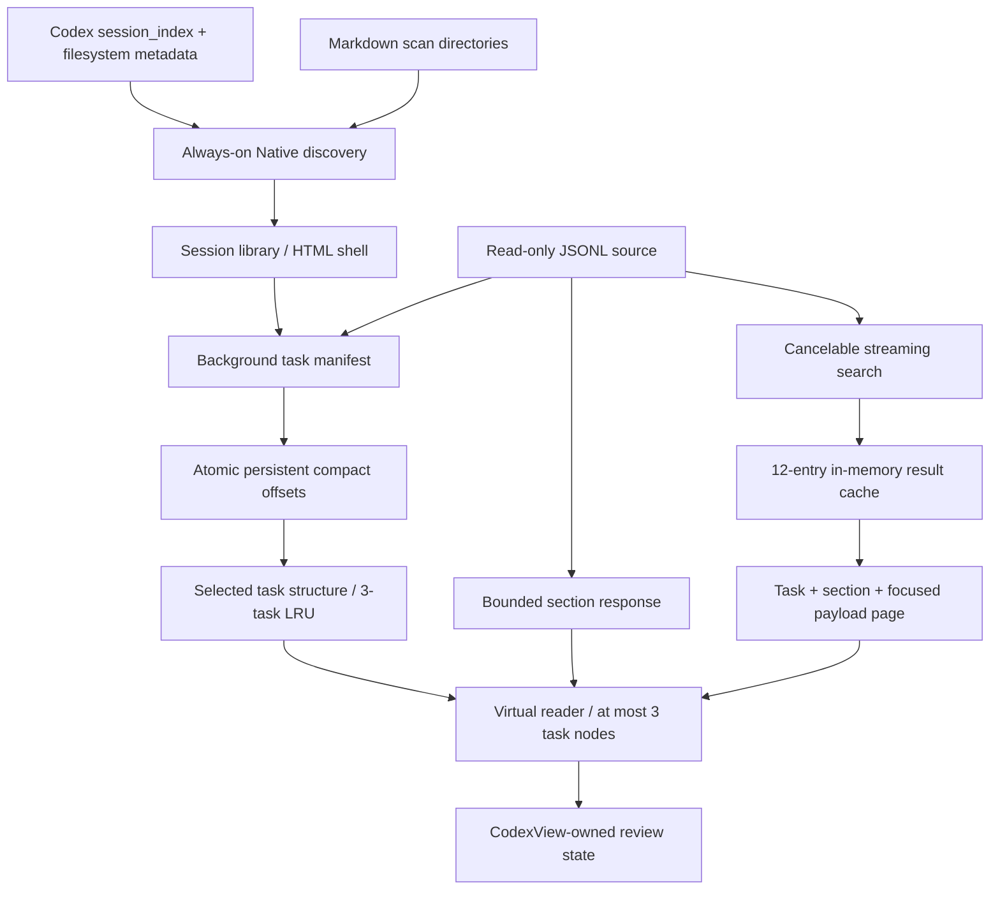

# Architecture

`src/server.py` contains adapters, discovery, manifest handling, HTTP and CLI. `src/web/reader.js`, `home.js`, `home.html` and CSS are embedded by `tools/build.py`. The distributed executable serves everything inline and does not require an asset server.

## Invariants

- Discovery is fixed-depth metadata scanning, with no Native-disable optimization.
- Shell rendering never calls the legacy whole-session section index. That code path has been removed.
- One manifest builder per session and one active builder globally. Readers receive preparation progress, not a blocking full index build.
- Persistent manifests use source identity, completed record offset and an 8 KiB checkpoint fingerprint. Truncation/replacement invalidates the generation. Appends preserve task IDs and review state. This is not a complete content checksum: arbitrary edits earlier in a same-size file are outside the append-only rollout assumption.
- Last incomplete JSONL line is left for a later refresh.
- Task metadata is loaded on demand. Only three parsed tasks are kept in the process-wide LRU; different browser sessions share that small cache.
- Section responses contain at most 262,144 characters for Native and 256 KiB for Markdown. A focus query selects the page around the hit. Decoding a Native record still requires its complete JSON line in memory.
- Search is sequential, cancellable and limited to 200 matching records. Cache identity includes source stat, manifest generation and offset, scope and query. At most 12 result sets remain in RAM; no transcript text cache is persisted.
- User notes and flags are atomically saved under a lock. Corrupt review state produces an error and is preserved. Current locking assumes a single CodexView server owns a runtime directory.
- Browser layout changes do not initiate task navigation. Current and adjacent tasks render asynchronously; loading earlier evidence preserves the current reading anchor.

## Compatibility

The adapter recognizes `response_item` message, readable reasoning and tool call/output records. It groups function calls and their outputs by call ID. A task currently begins with a non-empty user message; environment/plugin messages may therefore appear as tasks. Turn-aware task semantics and subagent trees require a separately tested adapter migration, preserving old review IDs.

Native `sessions/YYYY/MM/DD` rollouts and role-headed Markdown exports are supported. `session_index.jsonl` supplies titles without indexing transcript bodies. Archived session layouts and arbitrary newer Codex schemas require additional fixtures before support is claimed.

## Generated documents (development)

Session Markdown links point to `/file`, a separate shell. Only opening that shell requests `/api/file`. `ReportFiles` in `src/documents.py` performs bounded, descriptor-based read-only access beneath repeatable `--file-root` directories. It never participates in discovery, manifests, section loading, Activity or search. `src/web/markdown.js` is shared by the session and report readers.

Static HTML and relative raster/CSS resources are served through `/files/raw/<root>/<path>`, with sanitization, restrictive CSP and an opaque iframe sandbox. The source view inserts text through `textContent`. See [document-reader.md](document-reader.md) for capabilities and limits, and [the stable baseline](baselines/6.2.1.md) for regression policy.
